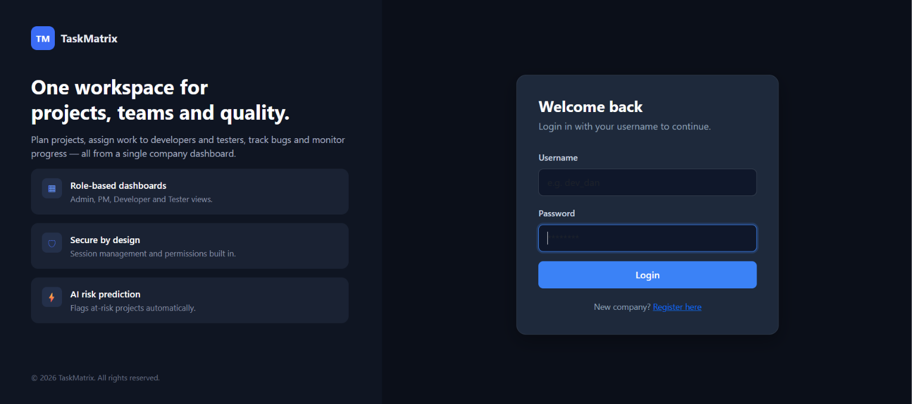
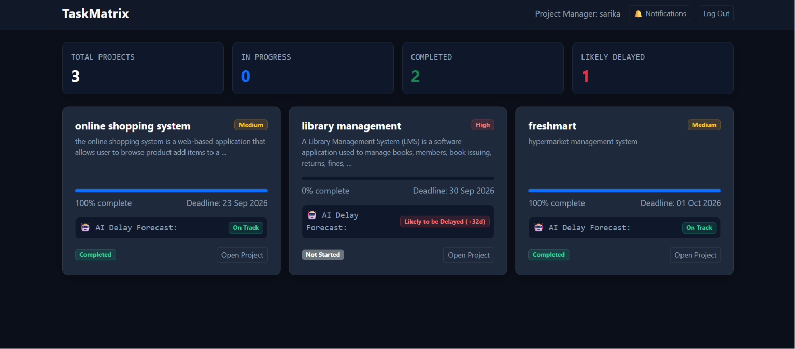
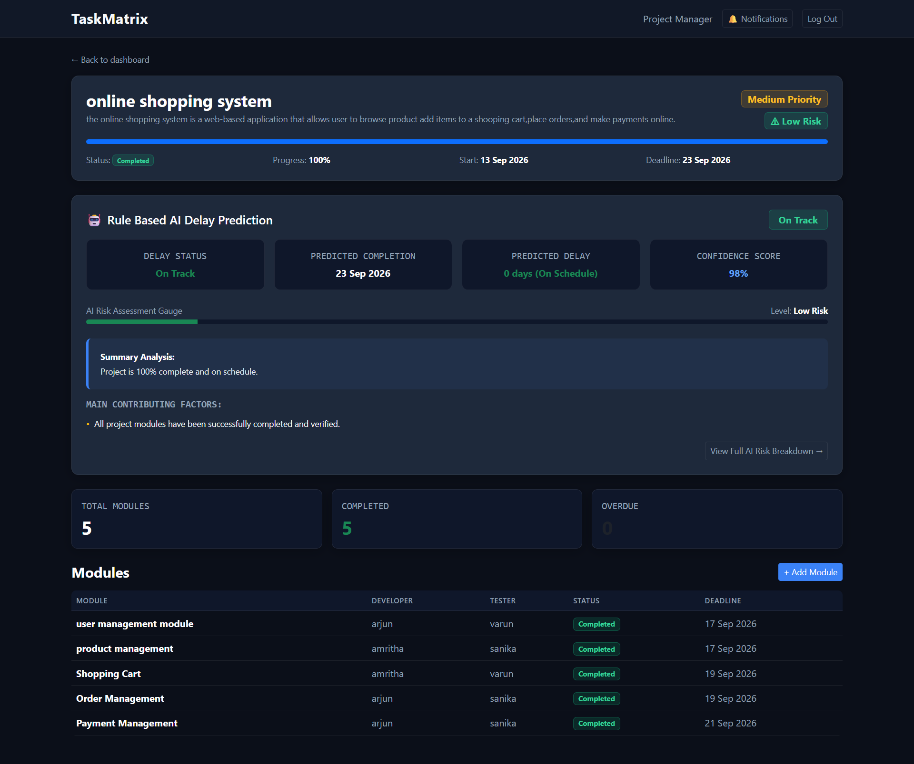
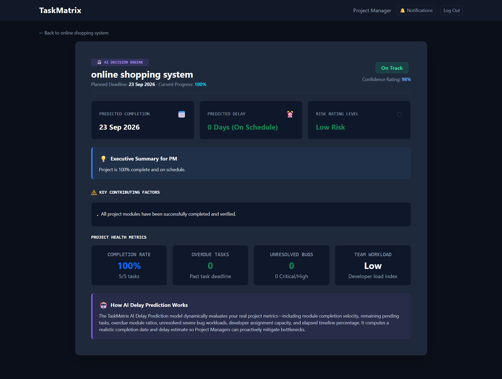

# TaskMatrix

A web-based project management system built with Python, Django and MySQL. It helps companies manage projects, assign and track tasks, submit files, report bugs and verify completed work.


## Screenshots

### Login


### Manager Dashboard


### Project Details


### AI Risk Prediction

## Features

- Separate dashboards for administrators, company managers, developers and testers
- Project and module management with task assignment
- File submission for completed work
- Bug reporting and tracking
- Verification of completed work by testers
- Notifications
- Rule-based AI risk prediction that flags project risks from overdue tasks, unresolved bugs and project progress

## Tech Stack

Python, Django, MySQL, HTML, CSS, JavaScript, Bootstrap

## Setup

1. Clone the repository

```
git clone https://github.com/AmrithaMS020/TaskMatrix.git
cd TaskMatrix
```

2. Create and activate a virtual environment

```
python -m venv venv
venv\Scripts\activate
```

3. Install dependencies

```
pip install -r requirements.txt
```

4. Create a MySQL database named `taskmatrix_db`, then create a `.env` file in the project folder:

```
DB_NAME=taskmatrix_db
DB_USER=root
DB_PASSWORD=your_mysql_password
DB_HOST=localhost
DB_PORT=3306
```

5. Run migrations, create an admin user and start the server

```
python manage.py migrate
python manage.py createsuperuser
python manage.py runserver
```

6. Open http://127.0.0.1:8000 in your browser.

## Author

Amritha M S
